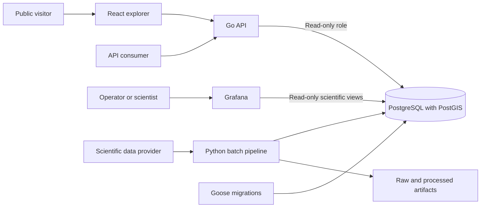

# System context and containers

The first vertical slice uses a single NSIDC product and entity, `hemisphere:south`. The pipeline will preserve original bytes and their SHA-256, validate the CSV, and publish accepted observations in one database transaction. Rejected records retain their original row locator. Persisted run state supports freshness reporting and keeps the last valid batch available after a failed run.

Goose owns schema changes. Python writes published batches and Go reads them to serve the versioned HTTP contract. React reads the API through the same-origin proxy. Grafana reads scientific views under its own role and is introduced as a separate interface.
