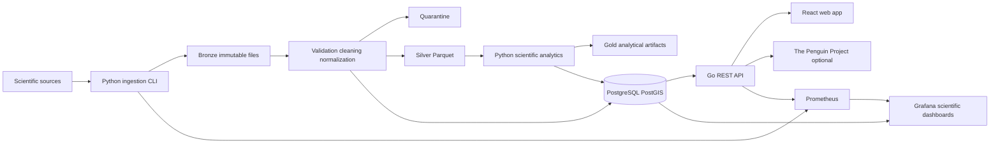

# Polar Observatory — Software Specification

**Estado:** revisión de diseño 2 (previa a v0.1.0) · **Fecha:** 2026-11-25 · **Idioma de interfaz:** inglés · **Despliegue:** local-first, Linux, Docker Compose.

## 1. Visión y alcance

Plataforma reproducible de observación ambiental antártica que integra datos científicos públicos, conserva su procedencia y permite consultar cambios estacionales, anomalías y cobertura. React es la interfaz pública principal; Grafana es una interfaz independiente de análisis científico y observabilidad operativa. Ninguna depende de la otra para funcionar. El valor propio reside en los adaptadores, validación, metodología científica, modelo temporal, API y automatización, no en replicar los portales de los proveedores.

Usuarios: estudiante/investigador exploratorio, divulgador, operador del pipeline y consumidor de API (p. ej. The Penguin Project). No es un servicio oficial de pronóstico, ni atribuye causalidad ecológica. MVP: Antártida, extensión diaria de hielo marino a escala hemisférica, histórico disponible, API Go, explorador React de hielo y actualización reproducible (v0.6.0). Después: estaciones, SST regional, Grafana completo, anomalías y mapa avanzado. Ártico, predicciones ML, correlaciones poblacionales, Kubernetes y aplicaciones móviles quedan fuera de v1.0.

### Soluciones existentes y diferencial

[NSIDC Sea Ice Index](https://nsidc.org/data/seaice_index/data-and-image-archive), [AMRDC](https://amrdcdata.ssec.wisc.edu/) y [NOAA OISST](https://www.ncei.noaa.gov/products/optimum-interpolation-sst) ya proveen observaciones y herramientas de consulta. La contribución es un pipeline interoperable, auditable y autoalojable, con controles de calidad, comparación temporal y vistas conjuntas. No se reivindica novedad científica ni ausencia de competidores.

### Propuesta de valor y evaluación

Problema: los datos ambientales están fragmentados entre catálogos, formatos, unidades, resoluciones y calendarios. La plataforma reduce el trabajo repetitivo de preparación y ofrece una API documentada, visualización accesible y procedencia verificable. No reemplaza los productos originales ni una investigación científica formal. Público inicial: estudiantes, educadores, investigadores exploratorios y desarrolladores.

| Indicador | Objetivo propuesto / método de validación |
|---|---|
| Tiempo de preparación | Reducción objetivo 80%; comparar tareas equivalentes con fuentes oficiales frente al producto, registrar minutos, errores y experiencia de participantes; no afirmar ahorro antes de medir |
| Integración | 3 fuentes aprobadas y al menos 5 métricas científicas; inventario por release |
| Cobertura | 20 años cuando el producto lo permita; mostrar huecos reales |
| Completitud | ≥99% de registros válidos esperados en un archivo verificable, no de observaciones inexistentes; reconciliar conteos |
| Trazabilidad | 100% de observaciones publicadas con fuente, artefacto, revisión y método |
| Reproducibilidad | Repetir ingesta y despliegue desde fixtures y configuración versionados |

## 2. Requisitos

| ID | Funcionalidad | Prioridad / aceptación |
|---|---|---|
| FR-01 | Catálogo de fuentes con versión, licencia/condiciones, cita y frecuencia esperada | MVP; toda observación referencia una fuente aprobada |
| FR-02 | Descargar histórico y sincronizar incrementalmente | MVP; repetir la misma descarga no duplica observaciones |
| FR-03 | Preservar artefactos originales y checksum SHA-256 | MVP; cada fila se vincula a un artefacto |
| FR-04 | Validar esquema, unidades, fechas, duplicados y valores faltantes | MVP; errores en cuarentena, sin sustituir nulos por cero |
| FR-05 | Dashboard de hielo y comparación estacional | v0.6.0 React; v0.8.0 Grafana; filtro de período, fuente visible, última actualización |
| FR-06 | Estaciones meteorológicas seleccionadas | v0.7.0; temperatura, presión y viento cuando estén disponibles |
| FR-07 | SST agregada por región oceánica | v0.7.0; máscara válida y cobertura informada |
| FR-08 | Mapa de estaciones y regiones | v0.10.0; coordenadas, leyenda y advertencia de proyección |
| FR-09 | Anomalías respecto a climatología fija | v0.9.0; baseline, método y cobertura visibles |
| FR-10 | API REST versionada, paginada | v0.5.0; OpenAPI y errores documentados |
| FR-11 | Salud del pipeline y alertas | v0.4.0 básica; v0.8.0 alertas completas |
| FR-12 | Exportación CSV de series filtradas y metadatos | v0.11.0; reproducible y con cita |

| FR-13 | Aplicación React con navegación, filtros y estados de carga/error/vacío | v0.6.0; funcional sin Grafana |
| FR-14 | Capas Bronze/Silver/Gold y reprocesamiento auditable | v0.9.0; resultados reproducibles por versión de método |
| FR-15 | Catálogo web, procedencia y calidad por observación | v0.6.0; acceso a citas y frescura |

NFR (objetivos de diseño, no mediciones): NFR-01 p95 de consultas API <500 ms para 10 clientes concurrentes y hasta 10 años de agregados diarios, medido en hardware documentado; NFR-02 consultas de dashboard <3 s en el perfil local; NFR-03 disponibilidad local objetivo 99% durante horas de operación, excluyendo mantenimiento planificado; NFR-04 RPO 24 h y RTO 2 h mediante backup probado; NFR-05 instalación desde clon limpio con un comando y configuración documentada; NFR-06 no depender de servicios de pago; NFR-07 accesibilidad por contraste AA para texto y etiquetas además del color; NFR-08 no declarar datos actualizados si la fuente está retrasada. Presupuesto inicial sugerido: 2–4 vCPU, 4–8 GB RAM, 20 GB disco para MVP, medir antes de ampliar.

## 3. Fuentes, ciencia y gobernanza

| Fuente | Producto / formato | Uso | Cadencia propuesta |
|---|---|---|---|
| NOAA/NSIDC | Sea Ice Index G02135 v4, CSV diario sur; archivos mensuales | Extensión hemisférica, tendencias mensuales | Consultar diariamente; revalidar últimos 14 días |
| AMRDC | Automatic Weather Station, archivos QC y metadatos por estación/año | Temperatura, viento, presión | Semanal; depende de publicación efectiva |
| NOAA NCEI | OISST v2.1 diario, NetCDF, grilla 0.25° | SST regional agregada | Diario; revalidar datos preliminares según producto |

Referencias verificadas: [archivo NSIDC](https://nsidc.org/data/seaice_index/data-and-image-archive), [instrucciones de descarga](https://nsidc.org/data/user-resources/help-center/how-access-and-download-noaansidc-data), [colección AMRDC](https://amrdcdata.ssec.wisc.edu/group/about/automatic-weather-station-project), [ejemplo QC](https://amrdcdata.ssec.wisc.edu/dataset/ago-4-automatic-weather-station-2024-quality-controlled-observational-data), [OISST metadata](https://www.ncei.noaa.gov/access/metadata/landing-page/bin/iso?id=gov.noaa.ncdc%3AC01606). Acceso público no equivale a licencia irrestricta: antes de activar cada adaptador registrar condiciones por producto, cita oficial, fecha de consulta, política de redistribución y límites; si es incierta, no publicar archivos crudos ni fixtures reales. No copiar imágenes de terceros sin permiso. No inventar endpoints: descubrir URLs oficiales mediante catálogo y probar un archivo real en fase 1. Mantener fixtures sintéticos marcados como tales.

### Metodología

- Extensión de hielo no es área de hielo ni concentración local. Usar la métrica publicada y su unidad original; normalizar a km² preservando valor y unidad de origen. No derivar tendencias de una sola semana; usar producto mensual para análisis de largo plazo.
- Climatología propuesta 1981–2010 para hielo y SST cuando haya datos comparables; media por mes-día o mes según producto, excluir 29 de febrero del baseline diario y mostrar política. Anomalía absoluta = observación − media; porcentual solo con denominador positivo. Exigir al menos 80% de años esperados por bin; mostrar n y cobertura. No mezclar versiones sin evaluación.
- Estaciones: UTC, conservar flags originales, datos inválidos fuera de agregados, no imputar automáticamente. Conversión explícita de unidades (°C, hPa, m/s). Dirección de viento circular; no promediar grados aritméticamente.
- SST: región definida por polígono versionado; convertir longitudes al intervalo [-180,180), usar máscara tierra/hielo y flags según documentación, ponderar celdas por área (cos latitud como aproximación para grilla regular), reportar proporción válida; excluir agregados bajo 80% de cobertura como regla inicial revisable. No confundir estimación interpolada con medición directa.
- Mapa: Grafana Geomap para estaciones y regiones aproximadas; Web Mercator distorsiona latitudes altas y no muestra el polo completo. No usarlo para calcular áreas. Vista polar EPSG:3031 como extensión mediante mapa estático generado con Cartopy o visor propio, sujeto a prueba de compatibilidad; no prometer raster polar nativo en Grafana.

## 4. Arquitectura



Monorepo con tres componentes desplegables: aplicación React, API modular Go y pipeline Python ejecutado por lotes. No microservicios adicionales. PostgreSQL es el contrato de persistencia: Python escribe observaciones y resultados; Go y Grafana leen con roles separados. Goose es el único propietario de migraciones. Los contratos OpenAPI y esquemas se versionan; no hay llamadas síncronas Go→Python para servir consultas. El pipeline publica lotes transaccionalmente; si falla, se conserva el último lote válido. React consume exclusivamente Go; Grafana consulta vistas científicas de solo lectura y Prometheus. 

Scheduler mediante systemd timer en host Linux o servicio dedicado con APScheduler (elegir uno en ADR; por defecto systemd timer que llama Compose run). Exclusión mutua mediante advisory lock PostgreSQL por dataset; timeouts, reintentos exponenciales con jitter para 429/5xx, respeto de Retry-After, límite de bytes, descarga temporal y rename atómico. Validar antes de transacción; actualizar observaciones y estado de run en transacciones coherentes; reconciliar archivos huérfanos al arrancar. El fallo de una fuente no bloquea otras. Backfill explícito por rango y modo dry-run. Guardar revisiones sin borrar historia; vista current elige revisión aceptada más reciente.

### Stack y decisiones

| Capa | Tecnología y decisión |
|---|---|
| Web | React, TypeScript, Vite, Tailwind CSS, shadcn/ui, React Router |
| Estado | TanStack Query para estado remoto; Zustand solo para filtros/estado local compartido; URL como fuente de filtros compartibles |
| Visualización | Apache ECharts, MapLibre GL JS, deck.gl para capas compatibles; vista polar EPSG:3031 mediante raster estático georreferenciado o visor especializado tras spike |
| API | Go, Chi, pgx, sqlc, slog, OpenAPI; context cancellation, timeouts, pool acotado, streaming de exportaciones |
| Migraciones | Goose SQL, una sola secuencia para ambos servicios |
| ETL | Python 3.12+ (minor probado), uv, httpx, Pydantic, Typer, NumPy, pandas, xarray, netCDF4, Pandera, GeoPandas, PyProj, PyArrow; psycopg para escritura PostgreSQL |
| Persistencia | PostgreSQL 16+ y PostGIS, archivos NetCDF/CSV originales y Parquet procesados |
| Telemetría | Prometheus, Grafana OSS, logs estructurados Python/Go; métricas de jobs cortos a través de estado persistido y colector Go, no depender de scrape durante un job |
| Pruebas | Vitest, Cypress, Go test, pytest, Ruff, mypy, golangci-lint |
| Entrega | Docker Compose v2, GitHub Actions, npm lockfile, go.sum, uv.lock |

Fijar versiones probadas y digests antes de release. Sin Redis, brokers, Airflow, Kubernetes ni ML en MVP. TimescaleDB se evalúa mediante benchmark y ADR. No instalar librerías avanzadas de mapa antes del spike polar. Grafana provisioning versionado.

### Pipeline científico detallado

1. Descubrir y aprobar producto, licencia, versión y esquema; crear adaptador y fixture sintético.
2. Extraer con descarga acotada, checksum, metadata HTTP, manifiesto y run ID. Bronze conserva bytes originales inmutables; paths por fuente/versión/hash.
3. Decodificar CSV/NetCDF según metadata (fill values, scale/offset, calendario, unidades, flags); validar esquema tabular con Pandera y grillas con comprobaciones xarray de dimensiones/coordenadas. Cambios incompatibles bloquean publicación.
4. Limpiar duplicados por clave natural y revisión; distinguir dato ausente, inválido, sospechoso y no aplicable. No imputar ni borrar extremos automáticamente. Cuarentena con código de error, localizador y referencia al original; nunca sustituir null por cero.
5. Normalizar unidades y UTC preservando representación original y precisión; si calendario no convertible, rechazar con motivo hasta definir método. Validar CRS, latitud/longitud, antimeridiano y geometría; no interpolar resoluciones sin método explícito.
6. Silver: Parquet particionado por fuente/año y observaciones PostgreSQL. Registrar esquema, versión de transformación, conteos, checksum, calidad y lineage. Reconciliar filas aceptadas, rechazadas y duplicadas. Escribir temporalmente y publicar manifiesto al completar transacción; reconciliar huérfanos.
7. Gold: agregados regionales, climatologías y anomalías con cobertura, n, baseline, versión de región/algoritmo y artefactos de entrada. Persistir resultados en PostgreSQL y Parquet cuando sea útil; no cargar todos los píxeles SST a DB.
8. Backfill por fuente/rango, dry-run, reintentos y reprocesamiento desde Bronze con versión nueva de método; mantener revisiones y resultados anteriores. Verificar idempotencia y paridad de cálculos mediante fixtures de referencia.

Cada etapa emite conteos, duración y motivos de rechazo. Un resultado científicamente válido puede ser extremo; los flags originales y los derivados se conservan por separado. Datos de baja cobertura no se publican como agregados confiables. El estado de frescura distingue fecha observada, fecha de publicación y última ingesta exitosa.

## 5. Modelo de datos y contratos

| Tabla | Campos principales / restricciones |
|---|---|
| sources | id, slug unique, provider, product, version, citation, terms_url, redistribution_status, expected_interval |
| artifacts | id, source_id, URL, retrieved_at UTC, sha256, path, bytes, etag, last_modified; unique(source_id, sha256) |
| ingestion_runs | id UUID, source_id, status, started_at, finished_at, counts, error_code, git_sha |
| stations | id, provider_station_id, name, geom Point SRID 4326, elevation_m, metadata_version |
| regions | id, slug, geom MultiPolygon SRID 4326, version; unique(slug,version) |
| observations | id, source_id, artifact_id, entity_key NOT NULL, metric, observed_at UTC, value nullable, unit, original_value, original_unit, quality_flag, revision, ingested_at; unique(source_id,entity_key,metric,observed_at,revision) |
| climatologies | source_id, entity_key, metric, baseline_start/end, bin, mean, n, coverage, method_version |
| quarantine | run_id, artifact_id, row_locator, reason_code, payload_ref |

Entity_key estable (hemisphere:south, station:provider-id, region:slug:version). Índices (entity_key, metric, observed_at DESC) y (source_id, observed_at); GiST geom; evaluar particiones por tiempo. Observaciones sin valor conservan null y flag; revisiones nuevas solo si cambian valor/flag/procedencia relevante. No meter cada pixel SST en PostgreSQL: conservar subset crudo y agregados; registrar máscara, versión de región y algoritmo.

API `/api/v1` (GET solamente para consumidores): `/sources`, `/stations`, `/regions`, `/observations?metric=sea_ice_extent&entity=hemisphere:south&from=2020-01-01&to=2021-01-01&limit=1000&cursor=...`, `/climatology`, `/health/live`, `/health/ready`. Fechas ISO 8601 UTC, intervalo [from,to), máximo 10 años y 1000 filas por página, cursor opaco ordenado por fecha e ID. Respuesta `{data:[{timestamp,value,unit,quality,source_id,artifact_id}],next_cursor,meta:{source_version,as_of}}`. Error `{error:{code,message,request_id}}`; 400/422 parámetros, 404 entidad, 503 DB. OpenAPI versionado, cambios incompatibles requieren nueva versión mayor de API. CORS allowlist solo si consumidor web lo requiere.

### Contratos adicionales Go / React

Agregar GET `/sea-ice`, `/ocean`, `/comparisons`, `/anomalies`, `/data-quality`, `/ingestion-runs` (resumen público sin errores sensibles) y `/exports/observations.csv` conforme releases. Los endpoints científicos reutilizan filtros, claves de entidad, unidades y metadata del contrato base. Exportación con límites de filas y rango, cancelación, cabeceras de descarga y cita/manifest de consulta; nunca exportar datos no autorizados. OpenAPI es fuente para tipos TypeScript generados; CI detecta drift. Go separa dominio, casos de uso, repositorios sqlc y transporte Chi; tests de contrato verifican códigos y payloads. React no replica fórmulas científicas ni accede directamente a DB.

## 6. Diseño visual y navegación

### Aplicación pública React

Identidad científica en inglés, minimalista y centrada en mapas y series; no dashboard administrativo genérico. Tema oscuro inicial: fondo #091524, superficie #122338, texto #E2E8F0, acento #38BDF8, secundario #94A3B8; ámbar y rojo para estados con etiquetas además del color. Tipografía sans legible, números tabulares, espaciado base 4/8 px, ancho máximo 1440 px, navegación colapsable móvil. WCAG AA como objetivo; teclado, foco visible, texto alternativo y tabla equivalente para gráficas.

| Ruta | Contenido y comportamiento |
|---|---|
| `/` | Overview: extensión, fecha observada, anomalía si disponible, frescura, gráfica y acceso al explorador |
| `/explore` | Mapa interactivo, selector de capa, región/estación, leyenda y fecha; vista polar tras validación |
| `/sea-ice` | Comparación anual, histórico y baseline; filtros por fechas y resolución |
| `/stations` y `/stations/:id` | Catálogo, mapa y series de temperatura, presión y viento con QC |
| `/ocean` | SST por región, cobertura, series y metodología |
| `/compare` | Comparar períodos/entidades compatibles; advertir si unidades o métodos difieren |
| `/anomalies` | Anomalías, baseline, cobertura, límites interpretativos |
| `/data` | Catálogo, procedencia, condiciones de uso y exportaciones autorizadas |
| `/methodology` | Métodos, glosario, limitaciones y referencias |

Wireframe desktop (datos no simulados en producción):
```text
[POLAR OBSERVATORY] [Overview] [Explore] [Sea Ice] [Stations] [Ocean] [Data]
[Region / Hemisphere] [Date range] [Data freshness + source]
[Sea ice extent] [Anomaly] [Latest observation] [Coverage]
[ Map / region context             ][ Seasonal comparison    ]
[ Historical series with baseline and quality annotations     ]
[ Methodology | Source citation | Download | Related views   ]
```

Filtros compartibles por URL; TanStack Query con claves por filtros y cancelación; manejar loading, empty, stale, partial y error sin presentar cero ficticio. Estado DEMO obligatorio para fixtures. Tooltips con unidades, fechas UTC, flags y fuente. Diseño responsive 390/768/1440 px; en móvil mapa y gráficos en una columna. Evitar fotos decorativas y mapas base externos sin licencia/atribución; usar datos geográficos autorizados y assets locales cuando sea posible. MapLibre/deck.gl no garantizan proyección polar; no presentar Web Mercator como mapa polar exacto. No prometer datos de hábitats hasta contar con geometrías válidas. Enlace opcional a Grafana para operadores autorizados; caída de Grafana no afecta React.

### Grafana: análisis científico y operación

 Estilo sobrio científico: fondo oscuro nativo, azul hielo #63B3ED, cian #38BDF8, blanco frío #E2E8F0, ámbar #F59E0B para retrasos y rojo #EF4444 para errores. Colores propuestos de series, no prometer controlar todo el tema Grafana. Comparaciones con trazos diferentes y etiquetas. Unidades en títulos/ejes, tooltips con fecha UTC, fuente y flags. No usar mapas decorativos ni fotos de fondo. Layout 24 columnas Grafana; 4 KPIs de 6 columnas, gráficas principales 16/8, tablas ancho completo. En pantallas pequeñas priorizar KPIs y una gráfica por fila; probar zoom y viewport 390 px. Sin animaciones innecesarias.

| UID / dashboard | Paneles y filtros |
|---|---|
| polar-overview | última extensión, fecha observada, anomalía, fuentes disponibles; serie histórica; comparativa mensual; tabla fuentes. Variables dataset, año, rango |
| polar-sea-ice | ciclo anual superpuesto, baseline, anomalía, mínimo/máximo mensual, cobertura; filtro años y resolución |
| polar-stations | mapa puntos, temperatura, presión, viento, tabla QC; selector estación y rango |
| polar-ocean | SST regional, anomalía, cobertura, método; selector región y período |
| polar-system-health | latencia API, tasa errores, pool DB, disponibilidad y recursos; filtros servicio/ventana |
| polar-data-health | última ingesta, edad de dato, runs, errores, filas rechazadas, duración, tamaño crudo; selector fuente |

Wireframe overview (desktop):
```
[Polar Observatory] [Source] [Year] [Time range UTC]
[Ice extent] [Anomaly] [Observed date] [Data status]
[ Historical extent (16/24)       ][ Seasonal comparison (8/24)]
[ Monthly anomalies               ][ Coverage and quality      ]
[ Sources, version, citation, last successful sync             ]
```
Cada panel muestra No data cuando no existen datos, no cero. Etiqueta DEMO si fixtures sintéticos. Enlaces a fuente y metodología desde descripción; variables sin interpolación SQL insegura. Dashboard JSON exportado y provisionado con UID estable; cambios UI deben sincronizarse al repo; datasource UID fijo, credenciales por entorno. Alertas operativas: ingest failure consecutivo >=2, fuente retrasada respecto a SLA configurable, caída DB, disco >80%. Alertas científicas separadas, informativas, sin inferir emergencia climática. Probar alertas con fixtures y reset.

## 7. Estructura del repositorio

```text
polar-observatory/
├── spec.md, README.md, CHANGELOG.md, CONTRIBUTING.md, SECURITY.md
├── LICENSE, DATA_LICENSES.md, Makefile, compose.yaml, .env.example, .gitignore
├── apps/web/
│   ├── src/{app,assets,components,hooks,layouts,lib,routes,services,stores,types}/
│   ├── src/features/{overview,explore,sea-ice,weather,ocean,regions,data-catalog,comparisons,anomalies}/
│   ├── public/, tests/, cypress/, package.json, package-lock.json, Dockerfile
├── services/api/
│   ├── cmd/server/
│   ├── internal/{domain,application,repository,transport,middleware,telemetry,config}/
│   ├── queries/, tests/, sqlc.yaml, go.mod, go.sum, Dockerfile
├── services/pipeline/
│   ├── src/polar/sources/{nsidc,noaa,amrdc}/
│   ├── src/polar/{extraction,validation,cleaning,normalization,geospatial,quality,analytics,storage,orchestration}/
│   ├── src/polar/cli.py, tests/, pyproject.toml, uv.lock, Dockerfile
├── contracts/{openapi,schemas}/
├── database/{migrations,seeds,views}/
├── config/sources.yaml, config/regions/
├── data/{bronze,silver,gold,quarantine,fixtures}/
├── infrastructure/{docker,systemd,prometheus}/
├── infrastructure/grafana/{dashboards,provisioning,alerts}/
├── docs/{architecture,adr,requirements,design,scientific-methodology,data-sources,data-dictionary,api,testing,runbooks,releases}/
├── scripts/
└── .github/{workflows,ISSUE_TEMPLATE,pull_request_template.md,dependabot.yml}
```

Cada ruta abreviada con llaves representa directorios independientes, no nombres literales. `apps/web` contiene vistas y componentes por feature; `services/api` contiene Go, SQL tipado y tests; `services/pipeline` contiene adaptadores y transformaciones científicas; `contracts` define interfaces entre componentes; `database` es propiedad de Goose; `config` contiene fuentes y regiones versionadas; `infrastructure` contiene provisioning y despliegue. `docs/architecture` conserva C4 y secuencias; `adr` decisiones numeradas; `requirements` trazabilidad FR/NFR; `design` tokens/wireframes; `scientific-methodology` algoritmos y referencias; `data-sources` licencias, frecuencia y contratos de origen; `data-dictionary` unidades, flags y esquemas; `api` ejemplos; `testing` protocolos; `runbooks` recuperación; `releases` evidencia y capturas propias. `data` runtime y backups ignorados, salvo fixtures sintéticos o autorizados y manifiestos pequeños. No credenciales ni datasets grandes en Git.

Go domain no importa infraestructura; application depende de interfaces; repository y transport implementan límites. Python separa transformaciones puras de I/O. React features consumen servicios tipados; no duplicar estado remoto. Tests unitarios sin red ni DB.

## 8. Desarrollo, seguridad y operación

Comandos a implementar en Makefile: `make bootstrap`, `make up`, `make down`, `make migrate`, `make ingest SOURCE=nsidc`, `make backfill SOURCE=nsidc FROM=2010-01-01 TO=2020-01-01`, `make test`, `make lint`, `make smoke`, `make backup`, `make restore` (confirmación explícita), `make demo`. Compose expone web 127.0.0.1:8080, Grafana 127.0.0.1:3000 y API 127.0.0.1:8000; proxy web same-origin /api en despliegue; DB y Prometheus solo red interna. Roles DB migrator, ingest_writer, api_reader, grafana_reader; solo grants necesarios. Credenciales aleatorias locales, no defaults en despliegue; secretos por archivos/env protegidos, TLS y autenticación si se publica. Validar hosts de descarga contra allowlist y redirecciones; limitar tamaño y descompresión; no aceptar URLs arbitrarias desde API. Contenedores no-root cuando compatible, no privileged, volúmenes mínimos, límites de recursos. Logs JSON con run_id/source/error_code sin secretos; métricas ingest_runs_total{source,status}, ingest_duration_seconds, ingest_rows_total{source,outcome}, source_last_success_timestamp_seconds, source_latest_observation_timestamp_seconds, raw_storage_bytes; no IDs únicos como labels. Liveness no exige red externa, readiness verifica DB y migración.

Backups diarios de DB + raw manifests y archivos, fuera del volumen primario; cifrar si hay credenciales, retención 7 diarios/4 semanales inicial; restaurar en entorno separado y verificar checksum. Retención raw propuesta 90 días para archivos descargables, conservar versiones que fundamentan resultados publicados o manifest y copia permitida; no borrar artefactos referenciados sin política. Alertas, runbooks, tiempos de recuperación y métricas operativas en docs.

## 9. Calidad, CI/CD y releases

PR/push main: actions fijadas a SHA completo y permisos mínimos. Workflows por componente con filtros de paths, más un check agregado obligatorio que siempre se ejecuta y verifica resultados aplicables (evitar checks pendientes por filtros). Subir logs y reportes aun ante fallo.

| Workflow | Gates |
|---|---|
| ci-web.yml | npm ci, ESLint, tsc, Vitest, build |
| ci-api.yml | gofmt, go vet, golangci-lint, go test -race, sqlc generate sin drift |
| ci-pipeline.yml | uv sync --locked, Ruff, mypy, pytest unit/contract, validación científica |
| ci-contracts.yml | OpenAPI lint, compatibilidad, generación de tipos TS sin drift, JSON schemas |
| ci-database.yml | Goose desde DB vacía y upgrade desde release previo, PostGIS, permisos |
| ci-integration.yml | Compose, fixture Bronze→Silver→DB→Go, idempotencia y rollback |
| ci-e2e.yml | Cypress, rutas, filtros, error/no data, UI funcional sin Grafana |
| ci-infrastructure.yml | Compose config, imágenes, provisioning y smoke Grafana/Prometheus |
| security.yml | secretos, dependencias npm/Go/Python, imágenes y SBOM |
| release.yml | tag protegido, gates completos, artefactos e imágenes inmutables |

Objetivo cobertura ≥80% de reglas críticas de dominio/transformación; no sacrificar calidad por porcentaje. Los cambios en contratos, DB o infraestructura disparan integración completa. CI usa fixtures deterministas sin dependencia de fuentes científicas externas. CD publica imágenes web/api/pipeline con misma versión y manifiesto Compose, no despliega automáticamente a producción. Escaneo dependencias (pip-audit), secretos y contenedores (Trivy u opción equivalente fijada), bloquear hallazgos críticos/altos explotables sin excepción ADR fechada. PRs de forks sin secretos ni permisos write; evitar pull_request_target con código no confiable. Rama main protegida con checks obligatorios y revisión cuando haya colaboradores; squash merge, Conventional Commits (`feat`, `fix`, `docs`, `test`, `refactor`, `ci`). Dependabot semanal. Scheduled source-check opcional solo consulta limitada y reporta cambios; CI normal jamás depende de red científica. CD: entrega continua, no despliegue público obligatorio; tag protegido `vMAJOR.MINOR.PATCH`, validar que apunta a main, repetir checks, build OCI inmutable, publicar GHCR solo si habilitado y publicar GitHub Release con changelog, checksums, SBOM, digest, instrucciones migración/rollback. Permisos contents:write/packages:write solo en job release. No secretos en artefactos. Rollback al digest anterior si esquema compatible; si no, backup/restore ensayado. Despliegue local mediante `docker compose pull && docker compose up -d` con versión fijada y smoke. No runner autoalojado expuesto a PRs públicos. Coste de licencia/infra local previsto cero, sujeto a cuotas GitHub, disco y electricidad.

SemVer: v0.x puede cambiar contratos documentando migración; v1.0 contrato estable; patch corrección, minor funcionalidad compatible, major incompatibilidad. Tags anotados: `git tag -a v0.1.0 -m "Design baseline"` y `git push origin v0.1.0` tras checks. No mover tags; corregir con nuevo patch. Releases iniciales de diseño pueden publicar solo docs; no anunciar imagen ejecutable hasta que exista.

## 10. Plan de releases y gates

| Release | Entrega | Gate verificable |
|---|---|---|
| v0.1.0 | investigación, requisitos, C4, ADR, catálogo, diseño | muestras oficiales y permisos verificados; mockup y contratos aprobados |
| v0.2.0 | base React/Go/Python, Compose y CI | clon limpio, health checks y workflows verdes |
| v0.3.0 | NSIDC y Bronze | checksum, manifiesto, descarga repetida y fallo de red probados |
| v0.4.0 | QC y Silver | deduplicación, nulls, revisiones, cuarentena, Parquet y DB validados |
| v0.5.0 | API Go/PostGIS | OpenAPI, sqlc, migraciones Goose, paginación y roles probados |
| v0.6.0 | React y hielo (MVP) | filtros, estados, citas y series correctas; funciona sin Grafana |
| v0.7.0 | AMRDC y NOAA OISST | dos estaciones con QC, región SST ponderada y cobertura validada |
| v0.8.0 | Grafana y Prometheus | dashboards provisionados, métricas de jobs y alertas probadas |
| v0.9.0 | Gold, climatologías y anomalías | baseline, leap day, cobertura y reprocesamiento reproducible |
| v0.10.0 | explorador geoespacial | CRS, antimeridiano, leyendas y limitaciones verificadas |
| v0.11.0 | exportaciones, optimización y robustez | CSV autorizado, benchmarks, backup/restore y límites medidos |
| v1.0.0 | release estable | FR/NFR aplicables verificados o excepciones documentadas; demo y runbooks |

## 11. ADRs, pruebas y riesgos

ADRs iniciales (propuestos, no aceptados automáticamente): 0001 React público y Grafana independiente; 0002 monorepo, API Go y pipeline Python con scheduler; 0003 PostgreSQL/PostGIS frente a TimescaleDB; 0004 raw immutable y revisiones; 0005 metodología baseline/QC; 0006 proyección polar; 0007 estrategia de licencia y atribución; 0008 API y versionado; 0009 política de retención; 0010 CI/CD y reproducibilidad; 0011 Bronze/Silver/Gold y publicación transaccional; 0012 Goose como propietario de esquema; 0013 contratos OpenAPI y tipos TS; 0014 React estado remoto/local; 0015 separación de roles y telemetría de jobs; 0016 evaluación de impacto y alcance científico. Cada ADR: título, fecha, estado, contexto, drivers, opciones, decisión, consecuencias, evidencia, condiciones de revisión. No reescribir decisiones históricas: supersede con nuevo ADR.

Pruebas: unit conversiones y anomalías; contract CSV con cambios de columnas/encoding y NetCDF con fill values; integration rollback, locks, idempotencia, permisos; e2e fixture → DB → Go → React y Grafana en ramas independientes; fallos red 429/timeout, disco lleno, archivo corrupto, DB caída; rendimiento con perfil reproducible; verificación visual manual desktop/mobile y colores; restore en instancia limpia. Riesgos: cambios de producto (schema version + contract), atraso de fuente (freshness visible), licencias ambiguas (bloqueo redistribución), mapas engañosos (CRS y advertencia), exceso de disco (subset/retención), comparaciones científicas inválidas (metodología versionada). Definition of Done: criterios aceptados, pruebas verdes, documentación y ADR actualizados, sin datos/secretos no autorizados, release notes y demo verificable.

## 12. Guía de aprendizaje y próximos pasos

Orden: leer catálogo y documentación de NSIDC, descargar CSV pequeño, explorar unidades y flags; aprender SQL temporal y PostGIS; diseñar C4 y ADRs; hacer spike de datasource Grafana, Go/sqlc y React/ECharts; construir vertical slice antes de AMRDC/NetCDF; estudiar xarray y climatología cuando corresponda. Documentación: [Grafana provisioning](https://grafana.com/docs/grafana/latest/administration/provisioning/), [PostgreSQL datasource](https://grafana.com/docs/grafana/latest/datasources/postgres/), [Geomap](https://grafana.com/docs/grafana/latest/visualizations/panels-visualizations/visualizations/geomap/), [PostGIS](https://postgis.net/documentation/), [xarray](https://docs.xarray.dev/), [GitHub Actions security](https://docs.github.com/en/actions/reference/security/secure-use). Referencias científicas heredadas de la revisión del 2026-11-24; no se revalidaron externamente en esta actualización. Documentación adicional para implementar: [React](https://react.dev/), [Go](https://go.dev/doc/), [Chi](https://github.com/go-chi/chi), [sqlc](https://docs.sqlc.dev/), [Goose](https://pressly.github.io/goose/), [Pandera](https://pandera.readthedocs.io/), [MapLibre](https://maplibre.org/), [ECharts](https://echarts.apache.org/). no se descargaron ni validaron datasets completos, ni se implementó el stack. Las versiones concretas, permisos por producto, endpoints de recursos y objetivos de rendimiento requieren spike y aprobación en v0.1.0.
